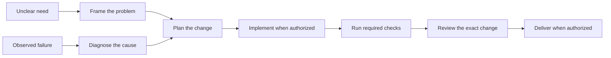

# Use the skills in daily work

**0.19 preview:** [Find your next workflow](start.md). Start with finishing existing work; commands and package identities differ from 0.18. No new client acceptance is implied.


After the first push, use [finish and maintain a draft PR](finish-existing-work.md#finish-and-maintain-a-draft-pr)
for bounded review, CI follow-up, evidence-based repairs, and an honest handoff.
It preserves the draft state and requires explicit authority for technical replies.

For unfinished changes and repairs, use [Finish existing work](finish-existing-work.md).

Start with one task and the smallest useful selection. The 0.19.0 preview
includes `daily-engineering-experimental`, a 12-skill selection for planning,
diagnosis, review, tests, Python, and GCP data work. Bounded Claude trials found
selection and output errors. Those observations do not qualify the profile or
establish measured benefit. See the dated evidence in
[release readiness](release-readiness-2026-10-20.md).

To build a feature, follow the [feature-development workflow](feature-development-workflow.md):
frame the need, plan, implement, check, review, verify completion, and open a
draft PR when authorized. It includes prompts for all three clients and a
shorter path for a well-defined change. Use the examples below for individual
tasks rather than treating every request as a full feature project.

## Prepare a selection

From a reviewed checkout, export to a new folder outside the repository. The
parent must already exist and have no symlink components. This creates files;
it does not install anything or change account settings.

```sh
python3 scripts/export_selected.py --profile daily-engineering-experimental --client codex --output /private/tmp/daily-codex-review
```

Use `--client claude` or `--client antigravity` for the other adapters and a new
output folder for each. Follow the relevant [client guide](client-support.md)
for a separately chosen installation. Keep the output receipt with that review.
The [selection guide](choose-your-skills.md) lists other packs and recipes.

The project projector is a different path: it accepts only read-only implicit
skills in shared discovery. This daily profile includes bounded execution
skills, so do not pass it through that projector or weaken its checks.

## Five useful requests

The examples below are synthetic, not observed client results.

| Request | Expected response |
| --- | --- |
| "The parser must accept empty input. Plan the change and its checks." | A concrete contract and tests before implementation |
| "Why is the build failing after this dependency update? Investigate first." | Reproduction evidence, a causal hypothesis, and the next discriminating check |
| "Review this PR for bugs; return findings without editing." | Findings tied to the exact diff, with severity and evidence |
| "Local tests passed. Is the fix live?" | Local success retained; deployment and runtime remain unverified without their evidence |
| "Review this incremental model; only supplied files may be inspected." | Grain, keys, late-data risks, and missing evidence; no warehouse query or backfill |

A successful answer can be brief: "The supplied checks passed at this revision."
An uncertain answer should name the missing proof: "Serving revision is unknown."
A blocked answer keeps the consequence: "The required integration service is
unavailable, so verification remains incomplete."

## Check whether the skill ran

Inspect the client's actual tool or skill-loading trace. Record the selected
skill, exact client/model version, source revision, and visible result. An answer
that sounds like a skill is not proof it loaded. A successful load is not proof
that its answer was correct. Check output quality separately.

If selection is missing or wrong, inspect the loaded inventory before rewriting
the prompt. A plugin copy and an account upload can duplicate the same skill.
Compare canonical identity, version, and path; do not delete either automatically.
In Claude Code, `/doctor` and `/context` can help inspect listing cost. Codex has
its own listing policy. Names, paths, and other installed skills also consume
space; description totals are estimates, not a universal client limit.

## Choose the next kind of work



Keep user authority controlling each action. Private facts stay in their owning
repository; personal preferences stay in client settings. A status question does
not replace the active objective. At handoff, retain exact state, evidence,
unfinished work, and existing authorization.

See the [offline trial protocol](../evals/daily-engineering/README.md) for the
prepared comparison. No trial, paid run, or installation is implied by this guide.
