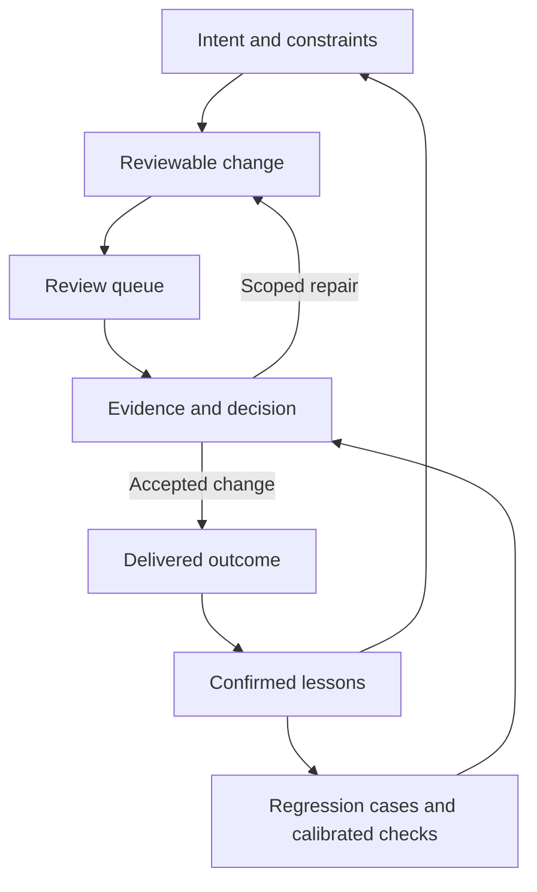

# Code review as part of the delivery system

Use Measured Skills to make a change understandable, assess its consequences, and
leave a decision another engineer can inspect. The useful output is a supported
decision about the change, including what remains unknown. Counting generated
code or review comments does not establish that result.

Start with [the review requests](code-review-workflow.md) when you have a specific
change. Use this guide when the problem spans authors, reviewers, tools, or the
way feedback reaches the next change. For prompt and agent behavior, continue to
[the two feedback loops](prompt-feedback-loops.md).

## Find the constraint before adding automation

A slow review can have several causes. More incoming changes can exceed available
review capacity. A small change can take a long time because its purpose, system
context, or owner is unclear. A dependency on another team can leave a finished
review waiting for a decision. Those problems need different responses.

| Suspected constraint | Evidence to inspect | Possible response to test |
| --- | --- | --- |
| Arrival volume exceeds review capacity | Ready changes entering and leaving the queue, age of open work, available qualified reviewers | Limit concurrent work, assign a reviewer earlier, or split independent purposes into coherent changes. |
| Reviewers must reconstruct intent | Repeated clarification, missing contracts, unexplained design choices | Improve the author's packet and link the decision that defines the requested behavior. |
| Changes repeatedly return for repair | Confirmed finding classes, repair rounds, failed assertions | Fix the recurring cause and promote a minimized regression case. |
| Review depends on one person's knowledge | Ownership map, unreviewed components, recovery questions only one person can answer | Share the relevant system model and arrange review with the responsible owner. |
| Checks pass while outcomes disappoint | Deployed versions, user outcomes, incidents, evaluation blind spots | Revisit the requirement or evaluator using new evidence. A green check alone cannot locate the cause. |

These are hypotheses, not diagnoses inferred from a dashboard. Separate time
waiting for review, time between first review and merge, and hands-on reviewer
effort. Calendar timestamps do not measure active labor. Look at the age of still
open changes as well as completed changes, or the worst delays can disappear
from the report. Compare comparable task types and account for incidents, staffing,
batch size, and changing requirements.

Recent research motivates examining the entire production process; it does not
establish that every team has the same constraint. The [dated evidence note](research/review-and-feedback-evidence-2026-11-18.md)
records the current study version, its limits, and the claims we can support.

## Keep two kinds of feedback visible

This diagram is a proposed workflow map, not a measured model of any team.

The repair path operates within the current task. The learning path changes what
future work asks for or checks. Give each path an owner and a stopping point.
Otherwise a review can keep generating work without settling a decision, while
production feedback accumulates without changing the next release.

A local improvement can increase pressure elsewhere. Faster drafting may increase
the review queue; adding a critic can increase latency and findings to adjudicate;
requiring more approval steps can concentrate work on the same unavailable owner.
Evaluate the effect at the receiving step as well as the step being changed.

## Preserve understanding as an engineering artifact

Google's [review guidance](https://google.github.io/eng-practices/review/reviewer/looking-for.html)
asks reviewers to assess design, surrounding context, complexity, and useful tests.
[Bacchelli and Bird's study](https://www.microsoft.com/en-us/research/publication/expectations-outcomes-and-challenges-of-modern-code-review/)
also describes knowledge transfer and change understanding as review outcomes.
These sources support reviewing more than isolated lines; they do not prove the
effectiveness of this catalog.

For a material change, the author and maintaining owner should be able to answer:

- What user or system behavior should change, and why does this change belong here?
- Which existing interface or behavior does it reuse? What alternative was rejected?
- Which caller, state transition, data rule, permission, or failure path matters most?
- What would falsify the main claim, and which check actually examined it?
- How would an engineer recognize a bad rollout and recover within the project's authority?

Record the answers where the next maintainer can find them. Ask the assistant for
a bounded explanation tied to code and contracts; inspect that explanation against
the source. A fluent account is not evidence that the author or reviewer understands
the decision. An owner can demonstrate understanding by explaining a tradeoff or
predicting an important failure path, without being required to handwrite every line.

Keep the packet proportional to the change. A spelling fix does not need an
architecture study. A short retry change may need a storage contract, concurrency
evidence, and a recovery decision because those determine its behavior.

## Use review to settle claims

For each material concern, preserve the reviewed revision, failure condition,
affected behavior, supporting evidence, counter-evidence, and proposed verification.
Separate a defect from a question, an optional improvement, and a cleared concern.
Use [the finding vocabulary](finding-vocabulary.md) when reporting findings.

A critic should receive the actual artifact, requirements, and evidence. A fresh
context can help separate its first assessment from the author's preferred verdict,
but the reviewers may still share assumptions or model errors. Agreement is a reason
to inspect the evidence, not a replacement for it. Use a specialist or responsible
human owner when the unresolved question requires their knowledge or authority.

The [synthetic retry example](code-review-workflow.md#worked-example-a-retry-that-might-duplicate-work)
shows a concern cleared by storage evidence. Recording that disposition prevents
another round from demanding a redundant fix. Reopen it only when relevant new
evidence changes the conditions, such as a different schema or an external effect.

End the pass when the requested decision is supported or the bounded evidence is
exhausted. State the remaining gap and who can resolve it. More comments, more
reviewers, or another identical critique do not establish progress. The existing
review workflow's finite round budget still applies; this guide does not reset it.

## Measure the outcome you intend to improve

Choose a small set of measures before trying a workflow change. The following are
candidate measures for a team's study, not telemetry this catalog or site collects.

| Question | Candidate measure | Interpretation limit |
| --- | --- | --- |
| Is work reaching a reviewer? | Time to first substantive review; age of ready work | Define substantive review and account for work that is still waiting. |
| Is a decision easier to reach? | Hands-on effort where reliably recorded; clarification and repair rounds | A complex correct change may need more discussion than a trivial one. |
| Are findings useful? | Confirmed, cleared, unsupported, and unresolved findings in a reviewed sample | A higher finding count is not the goal; missed defects also matter. |
| Is the system understood? | Another responsible engineer can explain the governing contract and recovery path | This requires a real comprehension exercise, not counting document views. |
| Are repeat failures prevented? | Recurrence of a confirmed failure class per relevant opportunity | Preserve exposure, version population, time window, and reporting changes. |
| Did users benefit? | The intended task outcome and relevant reliability measures after deployment | Merge counts and copied requests are not user outcomes. |

For an initial trial, name the task population, baseline workflow, candidate
workflow, review owner, and decision date. Keep the change scope comparable and
record the time spent preparing evidence as well as reviewing it. A workflow that
saves reviewer time by silently shifting more work to the author may still be
useful, but the total cost must remain visible. Include unsuccessful and abandoned
tasks with their known reasons instead of selecting only completed examples.

Separate three decisions: whether the change works, whether the evaluator can
detect failures, and whether the delivered change helps. A useful result in one
does not establish the other two. Current [client evidence](client-candidate-v0.19.0.md)
does not establish faster reviews, greater throughput, or preserved expertise.

## Copy a bounded systems review request

> Assess [CHANGE or WORKFLOW] in [REPOSITORY] using the supplied evidence. Identify
> its intended outcome, affected consumers and owners, governing contracts, and
> where work or feedback may wait. Separate confirmed constraints from hypotheses.
> Explain what the maintaining engineer must understand and what could clear each
> concern. Distinguish recovery within this task from improvements across versions.
> Return the supported decision, evidence gaps, and one next verification step.
> Inspect and recommend only; do not edit, run evaluations, collect telemetry,
> send messages, or publish.

Use [assess-change-impact](../skills/assess-change-impact/SKILL.md) for dependency
and delivery effects, [request-review](../skills/request-review/SKILL.md) for the
author's packet, and [learn-after-launch](../skills/learn-after-launch/SKILL.md)
for observations after deployment. Select the relevant capability; this is not a
required sequence or permission to expand the task.
