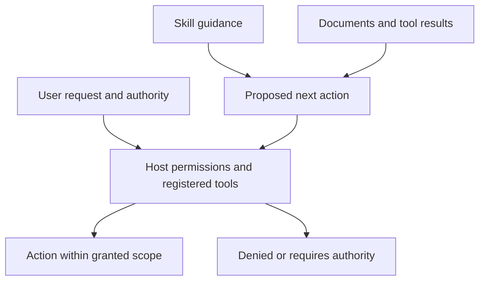

# Security Model

## Protected assets

The catalog protects user intent, credentials, private data, repository integrity, client configuration, publication state, and the trustworthiness of conclusions produced by a skill.

## Threats

- instruction text that broadens authority or hides side effects
- prompt injection embedded in imported skills or references
- hooks or scripts that execute during discovery or installation
- unpinned dependencies and mutable remote content
- excessive tool, filesystem, credential, or network permissions
- data exfiltration through commands, logs, URLs, or generated artifacts
- secrets and private identifiers copied into a public repository
- generated adapters drifting from reviewed canonical sources
- claims of successful validation, deployment, or parity without observed evidence
- repository-mounted instructions changed by contributors or compromised dependencies
- model-mediated tools receiving broader identity, data, tenant, or action authority than the host intended
- context, memory, retrieval, or tool-response poisoning in agent systems

## Catalog controls

- no skill-level executables, hooks, MCP servers, dependencies, output styles, or broad tool grants
- explicit-only controls for workflows whose timing or bounded mutations require direct selection
- generated native invocation controls checked against canonical metadata
- standard-library-only repository generation and catalog validation, with a separately locked workflow YAML parser
- immutable third-party GitHub Action revisions, enforced by repository validation
- hash-locked PyYAML, type information, mypy, and Ruff wheels with reviewed direct and transitive dependency provenance
- required trigger, provenance, reference, and public-boundary checks
- primary-authority provenance plus generic originality and repository-independence scanning
- explicit abort and state-advance gates for Git conflict reconciliation
- secret-free guided configuration and privacy-bounded handoff and retrospective workflows
- generated distributions compared byte-for-byte with a clean temporary build
- individual Claude.ai ZIPs with a bounded, inspectable root
- strict taxonomy, recipe-size, source-review, and maturity-evidence records
- separate assistant, API-managed, and ADK runtime trust boundaries

Host permissions remain the final enforcement layer. A skill is not a sandbox.

Repository-mounted skills are part of an agent's trust boundary. Pin and review the exact repository revision, minimize registered tools, isolate users and sessions, and preserve external authorization for consequential actions. Skill prose never grants a tool, credential, tenant, approval, deployment, or release state.

## Review decisions

Security review returns one of:

- `APPROVE`: no unresolved material risk within the declared use
- `CONDITIONAL`: acceptable only with named permissions, isolation, or modifications
- `REJECT`: licensing, execution, authority, exfiltration, or provenance risk is unresolved

A decision must identify the reviewed revision, material, behaviors, requested permissions, network activity, residual risk, and re-review triggers.

## Re-review triggers

Re-review when the skill body, references, invocation class, scripts, hooks, dependencies, permissions, client adapter format, network destinations, upstream ownership, or license changes. Revoke distribution immediately if a secret, incompatible license, hidden execution path, or material provenance error is discovered.

## Permission boundary

Skill text and retrieved documents help determine what to propose. They cannot
expand the host's permissions or the user's authorization. Review is distinct
from executing the action under review.
