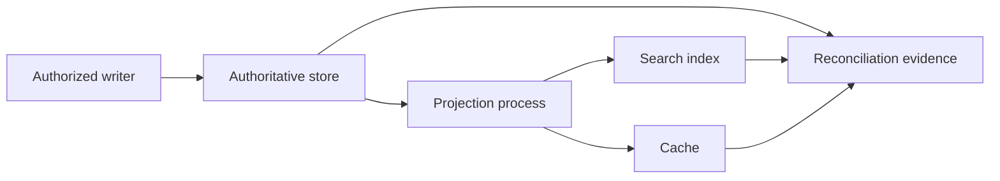

# Authority Boundary Review

Make authority claims explicit and verify them against operational behavior rather than diagrams alone.

## Workflow

1. Inventory relevant stores, queues, files, APIs, caches, and projections.
2. For each artifact, identify:
   - what fact or bytes it owns
   - who may write it
   - who reads it and for what decision
   - whether it is authoritative, derived, cached, archival, or proposed
3. Trace create, update, delete, retry, replay, backfill, and reconciliation paths.
4. Locate the ratified contract: code, schema, policy, ADR, configuration, or live provider state. Label unratified documents as proposals.
5. Test disagreement scenarios. State which source wins, how conflicts surface, and whether repair is automatic, manual, or absent.
6. Identify ambiguous dual writers, irreversible projections, missing version checks, or reads that bypass the declared authority.
7. Separate documentation corrections from physical migrations, writer changes, backfills, or deployments.

## Output

Lead with the answer. Use the shortest format that retains the required evidence and limits; expand when requested or needed. The items below describe required content, not mandatory headings.

Provide an authority matrix with `Artifact`, `Owned fact`, `Class`, `Writer`, `Readers`, `Conflict rule`, and `Evidence`. Follow it with confirmed boundaries, contradictions, proposed changes, and unresolved decisions.

Do not call a migration complete from schema or code changes alone. Writer cutover, historical data, reconciliation, deployment, and live reads require separate evidence.

## Example

Synthetic example; not an observed client result.

Input: Orders are written to a ledger and copied into a search index.

Output: The ledger owns order state; the index is a projection. Repair stale search documents from the ledger unless an approved contract says otherwise.

## Authority and projections

A projection can be rebuilt from its authority under an approved contract.
Neither a cache hit nor a matching total grants the projection write authority.
